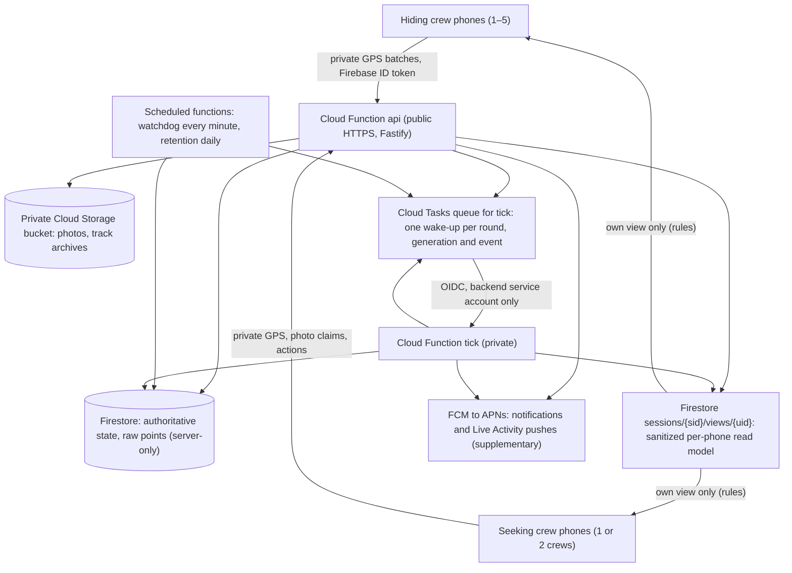
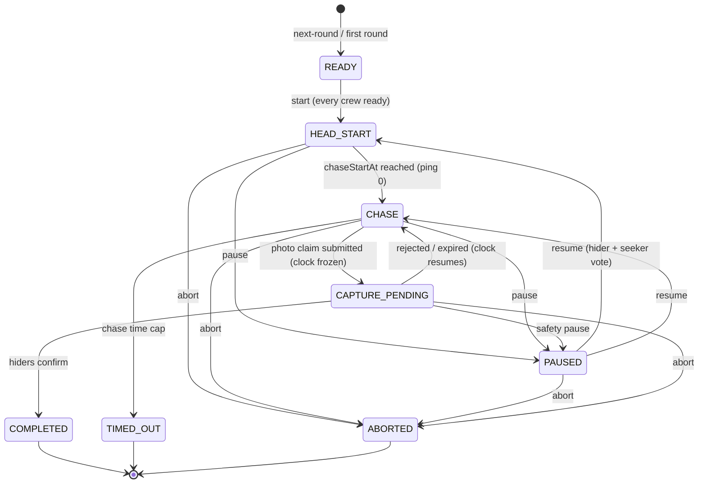

# Architecture

Manhunt Crews is a native iOS app and a small serverless backend on Firebase. The server owns the game: time, state transitions and what each phone may see. Phones send private GPS and actions, and each one reads only its own sanitized **view**.

Related: [data model](data-model.md) · [API](api.md) · [threat model](permissions-threat-model.md) · [scoring and retention](scoring-and-privacy.md) · [ADRs](adr/README.md)

## System overview

Phones also reconcile their view over REST (`GET /v1/sessions/{id}`) when the listener goes quiet (ADR 0010, 0016). Game timing never depends on the listener, REST or push.

## Components

### Backend (`backend/src`)

| Layer | Files | Responsibility |
|---|---|---|
| **Domain** (pure, no I/O) | `domain/engine.ts` | Round state machine: create, ready, start, chase start, ping, late release, claim, decide, expire, pause, resume, abort, time cap, disputes |
| | `domain/clock.ts` | Pause-aware time math. Every deadline derives from `roundStartAt`, `chaseStartAt` and `pauses[]` |
| | `domain/tick.ts` | Applies everything due at `now`, in order, and selects ping samples |
| | `domain/pingSelection.ts` | Which hider sample a ping may reveal: on time (§5.3) or late, for a waiting ping (ADR 0015) |
| | `domain/views.ts` | **The only producer of client-readable game state**: per-phone views, crew status, Live Activity content |
| | `domain/crews.ts`, `rules.ts`, `geo.ts`, `scoring.ts`, `types.ts`, `errors.ts` | Crew and snapshot helpers, rules validation and fingerprint, distances and simplification, scorecards and analytics, types, error codes |
| **Services** (Firestore, Storage, FCM) | `services/gameService.ts` | Every game transaction: load, apply the domain transition, write state and changed views, schedule the next wake-up |
| | `services/finalize.ts` | After a round: per-crew distances, routes, track archives, summary |
| | `services/socialService.ts`, `dataService.ts` | Profiles, friends, people, groups; analytics, exports, deletion, retention |
| | `services/liveActivities.ts`, `notifier.ts` | Live Activity token registrations and ActivityKit pushes; FCM notifications |
| | `services/scheduler.ts`, `storage.ts`, `repo.ts`, `firebase.ts` | Task-queue and local schedulers; the private bucket (with JPEG metadata stripping); Firestore paths and dependency wiring; Admin SDK setup |
| **API** | `api/app.ts`, `api/http.ts`, `api/routes/*.ts` | Fastify app: Firebase ID-token auth, per-uid rate limits, idempotency keys, gzip bodies, typed errors, `serverTime` on every response |
| **Cloud Functions** | `functions/index.ts`, `http.ts`, `tasks.ts` | The deployed surface (ADR 0012): `api` replays requests into the Fastify app; `tick`, `watchdog` and `retention` |
| **Worker** | `worker/app.ts`, `jobs.ts` | The tick payload, and a local-only HTTP twin of the deployed worker for `dev.sh` and tests (secret-gated, never deployed) |
| Entry points | `dev.ts`, `bootstrap.ts`, `config.ts` | Local runner; dependency builder; environment config (no secrets) |

The domain decides and the services persist. A transition is a pure function `(round, input, now) → { round, events, notifications }`. `gameService` runs it inside a Firestore transaction, writes the result, and re-renders only the views whose content hash changed.

### iOS (`ios/`)

| Area | Files | Responsibility |
|---|---|---|
| App | `App/AppModel.swift`, `RootView.swift`, `AppEnvironment.swift` | Root state: auth, the open night's live view, listener and reconcile, tracking against the server phase. Tabs: Play, History, Friends, People. Build config from xcconfig |
| Features | `Features/<area>/` | Screens: Auth, Home, SessionSetup, Lobby, Game, Capture, Recap, History, FriendsGroups, Settings. `Lobby/SessionContainerView` routes the open night by **server** phase |
| API | `Services/API/APIClient.swift`, `Endpoints.swift` | Typed REST client: retries with jitter, honours `Retry-After`, gzip for large bodies, conditional GET |
| Auth | `Services/Auth/AuthService.swift`, `TokenBroker.swift` | Firebase Auth (email/password; Apple when enabled); single-flight token refresh judged on server time |
| Location | `Services/Location/LocationTrackingCoordinator.swift`, `SampleFilter.swift` | Background GPS with `CLLocationUpdate.liveUpdates` + `CLBackgroundActivitySession` / `CLServiceSession` (ADR 0006), the cadence filter, adaptive uploads |
| Offline queue | `Services/OfflineQueue/TelemetryQueue.swift`, `EncryptedStore.swift` | AES-GCM encrypted on-disk queue of samples and unsent photos; idempotent batches |
| Realtime | `Services/Realtime/SessionViewListener.swift` | Listener on the phone's own view document |
| Clock | `Services/Clock/ServerClock.swift` | Server time anchored to a monotonic clock that keeps counting through sleep |
| Notifications | `Services/Notifications/NotificationService.swift` | FCM registration (paid builds) and local deadline nudges |
| Live Activity | `Services/LiveActivity/LiveActivityController.swift`, `RoundActivityContent.swift` | Starts, updates and ends the round's activity from the applied view; registers push tokens |
| Shared | `Shared/DesignSystem.swift`, `Theme.swift`, `JSONCoding.swift`, `Gzip.swift` | Glass and material components, tokens, coding, compression |
| Widget extension | `ManhuntCrewsWidgets/`, `LiveActivityShared/` | Live Activity presentations; attributes and wording shared with the app |

### Shared and infrastructure

| Path | What |
|---|---|
| `shared/openapi.yaml` | API contract. A unit test checks it against the registered routes |
| `shared/fixtures/live-activity.json` | Content generated by the server from real views, checked by the Swift mapping |
| `firestore.rules` | Clients may `get` only `sessions/{sid}/views/{their uid}` while an active member. Everything else is denied, and there are no client writes |
| `firestore.indexes.json` | Composite indexes and TTL policies |
| `storage.rules` | Deny-all. Photos live in a private non-Firebase bucket |
| `firebase.json` | Functions (predeploy: typecheck, unit tests, build), Firestore, Auth provider, Hosting, emulator ports |
| `hosting/public/` | Privacy policy and support pages. The contact email is filled in at deploy time |

## Round lifecycle

`HEAD_START`, `CHASE`, `CAPTURE_PENDING` and `PAUSED` are the **active** states: the secrecy invariant applies throughout them. The session moves `LOBBY → IN_ROUND → BETWEEN_ROUNDS → … → COMPLETED`. A night has no round count (ADR 0014): it ends only when a phone ends it.

## Data flows

**Crews and phones (ADR 0013).** A night has two or three crews (`A`, `B`, `C`). Each has a roster of names and 1–5 equal operator phones. One crew hides per round, and every other crew seeks. With two seeking crews the round is `TOGETHER` or `RACE`. When a round starts, each crew's consenting phones are frozen into `round.operatorsByTeam`. Every in-round permission (uploads, ping sources, claims, decisions, pauses) and every post-round artifact is checked against that snapshot. A phone that joins or moves mid-round watches until the next round.

**Private telemetry.** Each phone records samples (every ≈5–15 s or 10 m moving, 30 s stationary) into the encrypted queue. Hider phones upload every 15 s and seeker phones every 90 s (`POST …/location-batches`). A hider phone also uploads just before each ping deadline, and at once while a ping is waiting on it. After an outage the newest 20 fixes go first, then the backlog (ADR 0016). The server:
- stamps each sample with the phone's crew and role from the round snapshot, never from the payload;
- corrects device clock skew by `receivedAt − sentAt` (ADR 0007) and flags quality;
- inserts points idempotently by `pointId` under `sessions/{sid}/rounds/{rid}/points` (server-only, 30-day TTL).

Health goes to the member doc without a transaction, unless what other phones see would change (ADR 0016).

**Released game information.** At each deadline the worker runs the tick inside a Firestore transaction:
1. It queries hiding-crew candidates (`role == HIDING`) near the deadline.
2. `selectPingSample` takes the freshest qualifying fix across the crew's phones, with accuracy breaking ties within 10 s. A fix qualifies if it was recorded *and received* by the deadline, is ≤ 60 s old and ≤ 50 m accurate (both configurable), wasn't recorded during a pause, passes the per-phone spike check, and carries no disqualifying flag.
3. It appends an immutable `PingRelease`, creates `pings/p{index}` with `tx.create` (duplicate-proof), and re-renders the views that changed, all in the same commit.

With no qualifying sample the ping **waits** (ADR 0015). The next hiding-crew upload, tick or watchdog pass releases the crew's *current* position, labelled late.

**Views.** `views.ts` renders each member's view from session, round, members and the active claim. Its inputs contain no raw samples. The only coordinates it can emit are released pings, and it never says which phone a pin came from.
- Seeker views get the last *N* released pins.
- Hiding-crew phones get the capture request.
- Phones not in the round get neither.

Crew health is coarse: live/total phones and a state. A view is written only when its content hash changes, and `GET /v1/sessions/{id}` serves the stored view with an ETag (ADR 0016).

**Live Activities (ADR 0017).** `views.ts` renders the activity's content from that phone's own `RoundView`: phase, clock anchors, ping index and times, claim crew and outcome, never coordinates.
- The app updates the activity from every applied view.
- After each committed round change, the server push-starts it on the round's other phones, updates registered activities, and ends them with the round. These are ActivityKit pushes through FCM.
- A moment's notification rides on the activity update as its alert, in place of a duplicate push.

App and server share one mapping, pinned by `shared/fixtures/live-activity.json`.

## Server-authoritative timing

- `roundStartAt` is the server time of the start call. All deadlines derive from persisted `roundStartAt`, `chaseStartAt` and `pauses[]` via `clock.ts`. Pauses may overlap, for example a safety pause during a pending claim, and are unioned.
- `chaseStartAt` is the *official*, pause-adjusted deadline, not processing time. Ping 0 is scheduled exactly there.
- Ping *n* is due when effective (pause-excluded) chase time reaches `n × interval`. A capture claim opens a `CAPTURE` pause at submission. Rejection or expiry closes it, which shifts every future deadline.
- Clients render clocks as `accumulatedMs + (serverNow − runningSince)`. `ServerClock` anchors server time to a monotonic clock that keeps counting through device sleep, so neither changing the phone's clock nor locking it mid-round changes a timer.

## Scheduling and idempotency

- After every state change, the API or worker enqueues one task on the `tick` queue for the next event, with id `r-{roundId}-g{generation}-{event}`. Cloud Tasks dedups ids. `phaseGeneration` increments on every pause, resume and claim transition.
- The tick is idempotent: it processes whatever is due at `now`, in order, against state read in the transaction. Stale or duplicate tasks are harmless no-ops (ADR 0003).
- `tick` waits out an early arrival of up to 30 s and returns 503 for a longer one, so Cloud Tasks retries (ADR 0012).
- The watchdog (every minute) ticks every active round. That repairs missed wake-ups, re-checks a waiting ping and refreshes coarse crew status. It also re-enqueues the next wake-up, counts overdue deadlines (alerted) and retries unfinished finalization (`summaryReady === false`).
- Late processing never changes *which* sample is eligible, because selection is by deadline. A late release is labelled `delayed` with the measured dispatch latency.
- API writes accept an `Idempotency-Key`, and successful responses are replayed for 24 h.

## Post-round

`finalize.ts` computes, per crew:
- walking distance (total and chase) or driving distance (chase), coverage and quality, from the crew's best-covered phone;
- simplified polylines (Douglas–Peucker at 8 m, split at gaps over 120 s);
- a gzip GeoJSON raw-track archive per phone in GCS;
- the round summary.

Routes are served only after the round ends, only to the round's phones, and only when every phone in the round consented to post-round route sharing. "Delete my data" removes one phone's tracks and the pins released from its fixes, then recomputes its crew's route from the crew's other phones.

## Environments

| Env | Firebase project | Backend runs as | Scheduler |
|---|---|---|---|
| local | `demo-manhunt` (emulators) | `scripts/dev.sh`: Fastify API + local worker | In-process, exact |
| local (functions) | `demo-manhunt` | `npm run serve:functions`: Functions + Cloud Tasks emulators | Emulator: immediate delivery, early-arrival wait-and-retry |
| dev / prod | a dedicated project each | Cloud Functions 2nd gen, `us-central1`, service account `manhunt-backend@` | Cloud Tasks + Cloud Scheduler |

The iOS Debug configuration points at the local stack (`MH_DEV_HOST`), and Prod at the production project. See [development.md](development.md) and [deployment.md](deployment.md).
