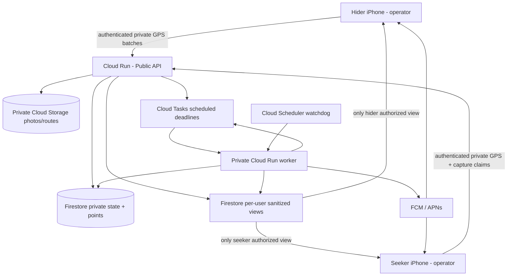

# MANHUNT CREWS — FULL-STACK CODING AGENT HANDOFF

**Status:** Implementation-ready product/technical specification (v1.0)  
**Prepared:** October 17, 2026  
**Target:** Native iPhone application + production-capable Google Cloud backend  
**Audience:** Coding agent implementing the application end to end  
**Working name:** *Manhunt Crews* (temporary; do not treat as a cleared App Store name)

> **Build objective:** Deliver an actually playable, friends-only, two-crew Manhunt game. One designated iPhone represents the entire hiding crew, and one represents the entire seeking crew. Automatically manage a configurable head start; reveal the hiders' location to seekers only on the configured schedule; record both crews' private live GPS trails for post-round replay, distance and history; capture photographic catches confirmed by the hiding crew; run multiple role-swapping rounds during a night; and preserve sessions, named rosters and analytically defensible crew statistics.

---

## 0. Coding-agent execution mandate

This document is a **build instruction**, not a request for an architectural proposal only.

1. Implement the native iOS app, backend API, persistent data models, live updates, cloud infrastructure configuration, background location tracker, notifications, photo capture, real gameplay timing, tests, documentation and deployment scripts.
2. Read this entire specification before implementing. Create short Architecture Decision Records (ADRs) if an implementation detail must vary, preserving all product behavior and privacy constraints.
3. Start with a vertical slice: two authenticated iPhones -> join session -> head start -> reliable server-driven first ping -> scheduled subsequent ping -> photo capture/confirmation -> completed round. Extend to role swaps, multi-round history, social features and analytics once this slice works.
4. No mocked backend, fabricated GPS or fake success states in the release build. Mocks are appropriate only for previews, local simulation and automated tests. Clearly mark external-service prerequisites.
5. Never expose the hiding crew's live track, raw GPS samples, upcoming location or actual current position to the seekers while a round is active. This includes Firestore subscriptions, API responses, notifications, thumbnails, logs, caches and analytics endpoints. A lobby host may also be a seeker and receives **no special spying privilege**.
6. Keep secrets, Firebase/Apple credentials and server service-account keys out of the repository and out of the iOS binary. Use short-lived server-issued upload access, managed identity and Secret Manager.
7. Make the server authoritative for state transitions, game clock, capture submission and ping release. Do not depend on either phone's clock or push-notification delivery for correctness.
8. Implement reliable degraded behavior for old/missing GPS data, offline phones, denied permissions, delayed tasks, stale builds and rejected photographs. Never silently represent stale locations as fresh.
9. Ship repeatable setup, iOS signing instructions, seed/demo/test accounts, local emulation, production roll-out steps, data deletion workflows and test evidence.
10. Do not buy paid services, enroll in an Apple account, change billing, or deploy to production without user approval and the required account access. Build everything possible locally first; report any entitlement-related blockers without pretending the feature is running.

**Source of truth:** Explicit user decisions below override defaults. All subsequent unconfirmed design details in this handoff are **recommended v1 defaults** that may be changed via configuration later; do not ask for new product questions unless a decision is genuinely blocking implementation.

---

## 1. Confirmed product requirements

| Category | Decision |
|---|---|
| Devices | iPhone only; native iOS frontend |
| Team structure | Two physical crews, not individual competitors; **exactly two participating phone operators** required for a round, one representing each crew |
| Seekers | One car, occupants travel together; a passenger uses the app, never the driver |
| Hiders | On foot, traveling together; one operator phone stands in for the group |
| Head start | Default 10 minutes, host-editable |
| First reveal | At **minute 10**, exactly when seekers' chase phase starts by default |
| Subsequent reveals | Every 10 minutes thereafter by default; host-editable |
| Pin history | Host sets how many previously revealed pins remain visible |
| Capture | Seeking operator takes an **in-app photo**, hiding operator **confirms** the catch |
| Game result | Record elapsed chase time; **no standalone single-round winner** |
| Multiple rounds | Crews switch roles; typically four rounds in a night |
| Analytics | Round/session history, comparisons, named crew rosters, changing membership across nights |
| Routes | Privately record more frequent GPS locations for both crews; replay each crew's route **after the round**, with distance traveled |
| Boundaries | No geofencing or boundary enforcement in v1 |
| Social | Accounts, friends list and reusable groups |
| Tracking | Screen-locked/background GPS is essential; push notifications expected |
| Distribution | Direct development builds first; private friends-only distribution later |

### Crucial interpretation

**One account/device is the operator for each crew; named members do NOT all need accounts or apps.** Example: Team A includes Morgan, Casey and Jules; only Morgan's iPhone is live-tracked. Team B includes Taylor, Riley and Sam; only Taylor's iPhone is live-tracked. The app measures **the operator device's route as a proxy for the crew's route**, not independent individual paths. Both operators authenticate. Non-operator friends can be added to team rosters as named people and later linked to stable person records for historical analysis.

Accounts/friends lists are for organizing and retrieving games, **not for requiring every hider/seeker to install the app**. The two operators stay physically with their own crews as roles alternate.

### Fairness and secrecy invariant

During HEAD_START, CHASE and CAPTURE_PENDING:

- **Hiding operator:** sees their own live location, route so far, timer, ping countdown and catch requests; does not see the seeking crew's live GPS.
- **Seeking operator:** sees their own live route and only **released, scheduled** hider location pins; does not see the hiding crew's raw path, latest unreleased sample or future location.
- **Both teams:** may see shared clock, game status, capture state and approximate connection/permission health indicators. Avoid health diagnostics that inadvertently include undisclosed coordinates.
- **After round completion:** both authorized operators can inspect both completed routes, photos where access is permitted, ping locations and outcome statistics. Historical route visibility is disclosed and consented to before starting.

This is enforced **at the server/storage authorization layer**, not by hiding UI components.

---

## 2. Core concepts and identity model

- **Account (`user`)**: A signed-in iPhone operator with a stable Firebase Authentication UID.
- **Person (`person`)**: A real human appearing in one or more named rosters. May exist without an account. Each person gets a stable internal `personId`, not just a free-text name.
- **Friendship**: Approved relationship between two app accounts. Can be used to organize sessions or groups; never grants raw location access automatically.
- **Reusable group**: A saved collection of people and optional friends, e.g. “Friday Manhunt.” This is a roster template, not a compulsory game participant set.
- **Crew/team**: A named team with a stable `teamId` within a session and a snapshot of `personIds`/display names. Two crews per session; their **identities persist as roles swap**.
- **Operator**: The ONE designated account/device sharing GPS for a crew in a given round. The operator remains assigned to their physical crew when that crew changes between hiding and seeking.
- **Session / night**: A series of rounds with a title/date, up to a configured count, two crews, name/roster snapshots, shared settings, scorecard and history. Recommended default: 4 rounds.
- **Round**: One chase with one hiding crew and one seeking crew.
- **Ping**: A single server-released point from the hiding operator, with the GPS observation timestamp, accuracy, age and reveal timestamp.
- **Track**: A sequence of GPS samples recording each operator's movement. **Tracks are private until round completion**.
- **Capture claim**: An in-app photograph submitted by the seekers and confirmed/rejected by the hiding operator.
- **Clock**: Server-based elapsed **chase** duration, starting after the head start, minus approved pauses. Head-start time is tracked separately.

### Roster identity and analysis safeguards

Persist `personId` references **alongside historical snapshot names** on every crew/round. A later nickname change must not rewrite old scorecards. Allow the same person to be assigned to different crews across nights; do not imply they were the live GPS source unless they were the operator.

When creating a new night, allow the host to pick existing persons, edit names, or create new persons. Duplicate-name handling should encourage matching the right saved person, not silently merge. If a previously guest-listed person signs up later, offer an explicit account-link/claim workflow with a crew organizer's confirmation. Avoid any unilateral identity claiming based only on a display name.

**Never label an individual's team outcomes as their personal capture time or distance.** Individual dashboards may show “Sessions played,” “Crew survival time in sessions they participated in,” “Win/loss equivalent for paired nights,” and “Crew compositions,” with conspicuous team-level attribution.

---

## 3. Gameplay lifecycle

### 3.1 Example four-round night

Saved teams: **Crew A** = Morgan / Casey / Jules; **Crew B** = Taylor / Riley / Sam. Each has one signed-in operator.

| Round | Hiding crew | Seeking crew | Tracked operator per crew |
|---|---|---|---|
| 1 | A | B | A's phone on foot; B's phone in car |
| 2 | B | A | B's phone on foot; A's phone in car |
| 3 | A | B | As in round 1 |
| 4 | B | A | As in round 2 |

Between rounds, users review the last result, physically reposition, check both phones, and tap **Ready**. The next round must **not automatically start** merely because the previous one ended; both operators must explicitly ready themselves. The role alternation should be suggested automatically, with the session host able to make a pre-round override (recorded in history).

### 3.2 States and transitions

`DRAFT -> LOBBY -> READY -> HEAD_START -> CHASE -> CAPTURE_PENDING -> COMPLETED -> BETWEEN_ROUNDS -> [READY ...] -> SESSION_COMPLETED`

Additional states: `PAUSED`, `TIMED_OUT`, `ABORTED`, `DISPUTED` (claim conflict) and `GPS_DEGRADED` **as a health flag**, not a replacement for the gameplay state.

| Transition | Trigger and authority |
|---|---|
| DRAFT -> LOBBY | Host creates a session, names crews and configures rules |
| LOBBY -> READY | Exactly one authorized operator per crew accepts invitation and actively agrees to GPS/route disclosure; both set ready |
| READY -> HEAD_START | Host presses Start; backend transaction creates official `roundStartAt`; both devices must have acceptable recent location/permission state or show explicit override warning |
| HEAD_START -> CHASE | Server event at `roundStartAt + headStartSeconds`; **first hider pin is released at this transition** |
| CHASE -> subsequent CHASE | Server releases one eligible hider position every `pingIntervalSeconds` after first reveal |
| CHASE -> CAPTURE_PENDING | Seeking operator successfully uploads photo and submits claim; server records authoritative time and provisionally pauses clock/location releases |
| CAPTURE_PENDING -> COMPLETED | Hiding operator confirms; official capture time is original **server claim-submission time**, not confirmation time |
| CAPTURE_PENDING -> CHASE | Hiding operator rejects or request expires; paused duration is excluded from clock and future ping schedule; show dispute reason and audit trail |
| CHASE -> TIMED_OUT | Configured maximum chase duration reached, if enabled; label as not caught, with a **censored** survival time |
| COMPLETED/TIMED_OUT -> BETWEEN_ROUNDS | Server stores score, distances, route summaries and consent-permitted recap |
| BETWEEN_ROUNDS -> READY | Both operators explicitly confirm the next roles and readiness |
| Final round -> SESSION_COMPLETED | Night scorecard and team/roster analytics become available |

**Pause behavior:** Host can propose a manual pause; both operators must confirm unless pausing is needed for safety/technical failure. Keep a complete pause/event log. A safety pause may be triggered by either operator and must be conspicuous to both. All timers derive from persisted `pauseIntervals`, not device-local timers.

### 3.3 Photo-confirmation semantics

- The seeker camera uses an in-app capture UI (native camera; no background facial recognition). After photo capture, show preview and **Submit catch**.
- Accept a claim only while round is in CHASE, from the seeking operator, with a successfully stored photo. Set `claimSubmittedAt=server time` and enter CAPTURE_PENDING in one idempotent transaction.
- At submission, **provisionally freeze the displayed chase time and block future hider location releases**. Retain private GPS samples temporarily, as appropriate, in case the claim is rejected.
- Notify the hider operator in-app and by push: show photo, crew names, claim time and **Confirm / Reject**. The operator may not confirm their own seeker-side claim.
- On confirm: set `officialFoundAt=claimSubmittedAt`, `foundAfterSeconds=effectiveChaseSecondsAtClaim`, `confirmedAt=server time`; stop both devices' active round tracking; finalize route cutoff at claim time for scoring, though retain a limited operational audit record of positions observed while awaiting confirmation if necessary and consented.
- On reject: resume the game from the frozen elapsed score/time; recompute all unreleased ping deadlines using accumulated pause duration. Do not retroactively leak coordinates from the pending interval as “missed pings.” Capture rejection reason optional; preserve internal audit data.
- Timeout while CAPTURE_PENDING: recommended configurable 120 seconds (range 30–600). Expire to CHASE; send reminders at appropriate times. Do **not** let a seeker-host unilaterally force-confirm.
- Allow both crews to jointly close a disputed claim after a game, with audit trail. Do not use face recognition to identify a photographed hider. Do not reward camera auto-detection as proof.
- Offline camera/upload: keep image encrypted locally and offer retry, but make clear the **official capture time is when the server accepts the completed claim**. Do not backdate using an easily forged local timestamp. Warn users if upload is slow.

### 3.4 Time definitions (must be consistent everywhere)

| Timestamp or metric | Definition |
|---|---|
| `roundStartAt` | Authoritative backend start of hiding head start |
| `chaseStartAt` | Nominal first reveal deadline; `roundStartAt + headStartSeconds + pauses during head start` |
| `firstPingAt` | First scheduled release at chase start, not 10 min later |
| `nthPingAt` | Chase-start plus `n * pingIntervalSeconds`, adjusted by valid pauses (`n=0,1,2,...`) |
| `officialFoundAt` | Server time of accepted capture submission, finalized upon hider confirmation |
| `headStartElapsedSeconds` | Time hiders were allowed to move before seekers started |
| `chaseElapsedSeconds` | Pursuit time from chase start to found/timeout, excluding approved pauses |
| `roundElapsedSeconds` | Total real round duration with separate pause display; do not confuse with score |
| `timeCapSeconds` | Optional max pursuit time; reaching it means uncaught / right-censored, not found |

Example: Round starts 8:00 PM; head start 10 min; first pin and seekers start 8:10; next pings 8:20, 8:30, etc. If photo is submitted at 8:36 and later confirmed, official chase time is **26 minutes** (absent pauses), not 36. On a stale/missing ping, mark it unavailable rather than revealing a later point.

---

## 4. Rules configuration and validation

Editable session settings, persisted as an immutable **effective rule snapshot per round**:

| Rule | Default | Recommended allowable range / notes |
|---|---|---|
| Hiding head start | 600 s | 0–3,600 seconds |
| Hider pin interval | 600 s | 60–3,600 seconds; first ping at chase start |
| Visible ping history | 1 | 1–50 previous released points; optional “all” for short rounds |
| Number of rounds | 4 | 1–20 |
| Roles in first round | Crew A hides | Host can choose A or B |
| Switch roles | After each round | Default on; explicit host override logged |
| Chase time limit | None | Optional 5–360 minutes; timeout marked uncaught |
| Photo confirmation expiry | 120 s | 30–600 seconds |
| Manual pauses | Enabled | Both operators see paused state; log reason |
| GPS position age accepted for ping | <=60 s | Service quality threshold; always show GPS sample age |
| GPS maximum reported accuracy for a release | <=50 m | If worse, release no position and show unavailable |
| Previous round route sharing | Both authorized operators, after round | Require disclosure/consent; never during round |
| Route-retention preference | See §11 | Privacy settings with delete ability |
| Unit system | Miles, optional km | User preference independent of stored meters |

Host may edit setup before a round starts, not during the chase. If round configurations differ, mark the session's score comparison as **not directly comparable**, and do not silently declare a winner.

---

## 5. Location tracking, delayed pin release and route distances

### 5.1 Two separate data flows

**Private telemetry:** Both operators stream GPS samples as available to the backend while their round is active. Store samples under strictly private server-controlled paths. The hider sample stream supports later route replay and scheduled ping eligibility; the seeker sample stream supports distance and post-round replay.

**Released game information:** At an official release event, the server selects exactly one *eligible* historical hider sample near the scheduled deadline, creates a `PingRelease` record and updates a role-scoped, seeker-readable view. A ping is **not** a live location subscription. Server task timing and client synchronization may vary; label a ping with both scheduled reveal time and underlying observation age.

For privacy/security, never mirror `latestHiderLocation`, `hiderRoute` or raw sample documents into a seeker-readable Firestore collection. Do not embed them in a public session document and hope UI ignores the fields.

### 5.2 iOS Core Location implementation

Implement a `LocationTrackingCoordinator` in Swift backed by Core Location. Use Apple's supported live-update/background-session APIs as appropriate for the minimum iOS version (recommended iOS 18+, with validation against current SDK):

- Explain, request and monitor foreground location permission; enable **Background Modes > Location updates** with the required Info.plist declarations and explanatory privacy strings.
- Start an authorized location/background activity session **while the operator actively initiates a round in the foreground**. Keep it active only while tracking is required; stop immediately after the round, consent revocation, or logout. Prefer modern `CLLocationUpdate.liveUpdates`, `CLBackgroundActivitySession`, `CLServiceSession` where stable; alternatively use `CLLocationManager` with `allowsBackgroundLocationUpdates=true` and correct plist capability.
- Handle reduced accuracy, permission withdrawal, system suspension, app termination, force-quit, Low Power Mode, airplane mode, no network, low battery and GPS-denied states. Force-quitting can prevent expected background delivery; do not claim to bypass it.
- Record `recordedAt`, latitude, longitude, horizontal accuracy, optional speed/course, and monotonic local ordering. Deduplicate and sanity-check. Queue samples safely on disk while offline; upload on reconnection with idempotency. Use iOS Keychain for tokens and file protection for GPS queue data.
- Target a practical sample cadence of **roughly 5–15 seconds when moving** or ~10–25 meters of movement, adapting for battery and stationary periods; do not promise fixed iOS background execution. Upload compressed batches approximately every 15–30 seconds when networking permits. The **10-minute pin interval is not the recording interval**.
- Use activity context `fitness` or equivalent for the hider's walking phase and automotive/appropriate location activity for the seeking car where supported. Benchmark, then tune accuracy/distance filter to avoid battery drain.
- Track presence/health status without leaking any undisclosed coordinates to the opposing crew. Display “Location stale,” “Tracking stopped,” “Precise Location disabled,” and “No network” promptly.

Apple explicitly documents that background execution can be suspended and location delivery can vary. A fixed-time cloud scheduler cannot magically compel an iPhone to produce a fresh GPS fix. **Guarantee scheduling and access control, not the arrival of a perfect fix.** See sources S1–S3.

### 5.3 Eligibility rule for a pin (server)

When a ping event scheduled for `deadline` is processed, find the **latest qualified hider sample** such that:

1. Sample belongs to the designated hiding operator/device for this round.
2. `recordedAt <= deadline` and `receivedAt <= deadline` (or a deliberately defined grace-window policy that never relies on a future fix); timestamps and trust bounds validated by backend.
3. `deadline - recordedAt <= 60s` by default.
4. `horizontalAccuracyMeters <= 50` by default and GPS point not rejected by anomaly filters.
5. Sample is within the official active period, and the round wasn't paused/capture-pending at the event.

If none qualifies, emit a **missing/stale ping event**, timestamped and visible to seekers, with *no coordinates*. Never substitute the last valid point without labeling it stale; if a previously released pin remains visible, preserve its original timestamp. An offline batch delivered much later may improve the historical route, but **must not be revealed retroactively as if it had been available to seekers at the time**.

A successful ping is an immutable event `{pingNumber, scheduledAt, releasedAt, positionObservedAt, lat, lon, accuracyMeters, sourcePointId, ageSeconds}`. Apply history count (1, 2, 3…all) to the **released point layer**, preserving full authorized history for recap.

### 5.4 Server-driven scheduling

- On round start, use **Cloud Tasks** to schedule the first ping/chase-start deadline and subsequent events. Use task OIDC credentials to invoke a **private worker Cloud Run service**. The public API is separate from this service.
- One next-deadline task per round suffices. Each task carries `sessionId`, `roundId`, `phaseGeneration`, `pingIndex` and immutable deadline; back-end handler is **idempotent**, checks state/generation, executes a Firestore transaction, creates exactly one release record, then schedules the next eligible deadline.
- Every pause/resume, capture state transition and role change increments a `phaseGeneration` to invalidate stale tasks. Recompute official deadlines using server timestamps and pause totals. Task retry must never publish duplicate pings or apply outdated deadlines.
- Have a **Cloud Scheduler watchdog** (e.g. once a minute) verify that an active round's next deadline has a pending task or has been completed; repair missing tasks and mark delayed reveals transparently. Do not rely on a permanent in-memory timer, app timer, or FCM notification to release pins.
- A Cloud Tasks scheduled dispatch is not a hard real-time guarantee. Aim for prompt dispatch, record delivery latency, and warn on operational delay.

### 5.5 Routes, distance calculation and replay

- Store valid raw samples and derived **GPS route segments** for **each operator**. Draw full polylines on the round recap map; use distinct stable crew colors across the night. Mark start, chase start, disclosed pings, photo-claim point, end and time gaps.
- While the round is active, show only the operator's **own** continuous path. Seekers' map has their own polyline plus released hiding-crew pings. Never show the hider's continuous polyline to seekers until round completion. Hiders should not see the seeking crew's active polyline either.
- Distances come from accepted consecutive GPS observations (meters internally), not a straight-line sum from 10-minute pings. Ignore low-quality fixes, small stationary jitter, implausible jumps, and segments crossing large data gaps; document thresholds and flag approximate estimates.
- Report separate columns: **hider crew total on-foot distance (head start + chase); hider distance during chase; seeking crew vehicle distance during chase**. Do not directly compare walking miles to driving miles as one performance score.
- Persist small simplifed polylines + route metrics for history; preserve enough detail to render credible routes without retaining every raw sample indefinitely. Simplification tolerance may be ~5–15m, adapted to zoom/quality and tests; preserve start, end and significant turn points.
- If GPS quality is poor, use “Estimated from available GPS” and show coverage; do not backfill imaginary streets/routes.

---

## 6. Scoring, session history and participant analytics

### 6.1 Round results (no single-round winner)

For each round display:

- Hiding crew and seeking crew names and roster snapshots.
- Head-start duration; **chase time until confirmed photo** (`foundAfterSeconds`); result `caught`, `timed_out` or `aborted`.
- Hider walking distance (total and chase-only), seeker vehicle distance, route coverage/accuracy indicator.
- Number of scheduled ping slots, successful pings, missed/stale pings, visible pins, pause duration and any tracking gaps.
- Official photograph timestamp and thumbnail (authorized view only), time of confirmation, capture-point annotation.
- Post-round side-by-side routes with a scrubbable replay timeline (phase 2 if needed) or static polylines with time markers (minimum first playable release).

**No “Round 1 Winner” banner.** A round is one attempt. The crew comparisons matter over a balanced multi-round night.

### 6.2 Night scorecard

For a balanced alternating 4-round night, Crew A hides in rounds 1/3 and seeks in 2/4; Crew B hides in 2/4 and seeks in 1/3. Compute:

- `hideSurvivalTotalSeconds` and `hideSurvivalAverageSeconds` per crew, **only across rounds it hid**.
- `seekCaptureAverageSeconds` across rounds it sought, lower is better; mathematically the same times as the opponent's hide rounds in this two-crew format.
- `hideRoundCount`, `caughtCount`, `uncaughtCount`, capped/timeout flags.
- `hiderFootKm`, `seekerVehicleKm` and route coverage, reported separately.
- Per-round pairing visualizations and trend of chase time through the night.

Primary comparison: **longer average uncapped survival while hiding is stronger**, which also implies the opposite crew took longer to find it. Do not declare an overall winner if crews hid an unequal number of times, time caps differ, or unresolved/censored rounds make direct ranking misleading. Show “Provisional comparison” and explain. Session can still display useful descriptive statistics.

**Censoring rule:** If a crew remains uncaught at a 60-minute cap, record `durationObserved >= 60 min, result=timed_out`, not “found at 60 min.” Do not treat this the same as a real 60-minute catch in means without labeling/adjustment. For v1, show observed values and flags; avoid overly sophisticated statistical estimators.

### 6.3 Across nights

- Session history timeline, searchable by date, crew name, participants and group.
- Person-level appearances: times participating, team rosters, co-player combinations, hide/seek rounds in which their crew participated, **team-level** elapsed time and distance; drill-through to session details.
- Crew compositions change between nights: derive a canonical fingerprint from sorted `personIds`, while preserving each historical session's named crew identity and snapshot. Provide composition-based aggregated analytics (`played as these three people`) separate from the one-night label “Crew A.”
- Operator-specific GPS instrumentation details should be labeled as such and not attributed to other roster members.
- Export **CSV of sessions/round scores and participants**, JSON of detailed scores; restricted download of route GPX/GeoJSON only with consent of both operators for that session, or appropriate per-operator permission.
- Avoid false causal claims such as “Taylor makes hiders faster.” Present observational correlations only, indicate sample counts and small-sample uncertainty.

### 6.4 Examples for acceptance

- Round A hides, B seeks: chase 26:00 -> A `hideSurvival=26:00`, B `seekCapture=26:00`.
- Round B hides, A seeks: chase 18:00 -> B `hideSurvival=18:00`, A `seekCapture=18:00`.
- If the only two rounds have identical settings and valid catches, Crew A has better survival (26 > 18 min); the **night comparison** can name the stronger performer, but neither individual round gets a winner.

---

## 7. iOS app experience and screens

Use **SwiftUI** with a simple outdoors-readable design; dark/light mode; large clocks, high-contrast map overlays, obvious phase labels, strong connection/permission warnings and large touch targets. Use MapKit, not a constantly refreshed Google Maps screenshot.

### 7.1 Screens

1. **Welcome / Authentication** — Sign in with Apple as the preferred mature distribution flow. If paid developer program is not yet available during development, temporarily support email/password or email-link Firebase authentication; keep account UID stable through linked providers. Show privacy summary and account deletion.
2. **Home** — Resume active session; Create Night; Join Night; History; Friends & Groups; settings. Active game prioritized.
3. **Friends** — Send/accept friend requests via invite link or handle; block/remove; no public location or discoverable location map.
4. **People & saved groups** — Manage named guest people, merge duplicate guest records with safeguards; create reusable crew templates; see roster history.
5. **Create night wizard** — Name/date; two crew names; each crew roster; designate operator accounts; first hiding crew; default 4 rounds; rules advanced editor; route/history consent notice; generate time-limited invite.
6. **Join lobby** — Code/deep link, role/team assignment, display saved rosters, acknowledge tracking/route disclosure, accept location permissions, show camera/notification readiness.
7. **Lobby / Readiness** — Two large crew tiles, online/GPS/permissions status, rule summary and ready/start. “Exactly 2 tracking iPhones” reminder. Require the two distinct accounts.
8. **Hider game map** — Private live route, own position, countdown for head start, next expected ping, elapsed chase time, GPS/battery health and “Location sharing ACTIVE” status; no seeker's live path.
9. **Seeker game map** — Private own-car route, **last N hider ping positions** with timestamp and accuracy, countdown to next reveal, game clock, big “Photo catch” action; no live hiding path. Show “PASSENGER ONLY” notice and keep critical tap workflows simple.
10. **Camera/photo preview** — Camera, photo retake, submit confirmation claim; upload progress and retry state; show provisional timer freeze only after server confirms submission.
11. **Hider catch confirmation** — Photo, time submitted, Confirm/Reject, expiration countdown, clarification that confirmation finalizes the time of submission.
12. **Inter-round recap** — Clock, route lines for both teams, walking/driving distances, pins, GPS quality, photo (if confirmed), timeline, optional dispute tools and next-round ready flow.
13. **Next-round role-swap** — Crew A/B roles switch, physical preparation checklist, 2 operators ready. No surprise automatic start.
14. **Night summary** — Four-round comparison, averages/totals, maps, member roster and historical save/export options; no single-round winners.
15. **History / Session detail** — Past nights, individual rounds, map replay, person/group stats, CSV export, delete session/route data.
16. **Settings / Privacy** — Account, notification preferences, units, location diagnostics, data retention and download/delete controls.

### 7.2 UX refinements

- Phase banner with server-derived clock and “Next reveal in M:SS”; display “Last hider ping 3m ago (GPS sample age 14s)” rather than presenting a stale dot as live.
- The map distinguishes (a) **own live blue-dot and trail** and (b) **opponent's released pin** (different color/style/time label).
- Reconnect screen compares server phase/state/version; never continue a local fake clock after the session ends.
- Hider tracking status is visible and manually stoppable if safety/privacy demands it, with a fairness warning to both crews.
- If the seeking car starts moving while the operator has an active camera/map interaction, use a non-blocking passenger safety reminder. Don't use phone sensors to infer who is driving with certainty.
- Dynamic Type, VoiceOver labels, colorblind-safe pin patterns, reduced-motion support, screen lock and battery-aware display.

---

## 8. Recommended implementation architecture

### 8.1 Stack

| Layer | Choice | Reason |
|---|---|---|
| iPhone app | Swift + **SwiftUI**, Swift Concurrency, MapKit, Core Location, AVFoundation/PhotosUI | Native camera/background GPS and fast map UI |
| iOS auth | Firebase Authentication; **Sign in with Apple** for friends distribution, optional email link in dev | Secure stable UID; friend/account model |
| Public backend | Node.js LTS + TypeScript + **Fastify** on Google Cloud Run | Typed, stateless REST API, good testing and GCP integration |
| Data | **Cloud Firestore** | Durable sessions/friends/rosters, server transactions, role-scoped real-time read models |
| Object storage | **Google Cloud Storage** private buckets | Photos and route archives |
| Server timers | **Cloud Tasks -> private Cloud Run worker**; Cloud Scheduler watchdog | Server-time delayed events, retries and idempotence |
| Real-time UI | Role-scoped Firestore snapshot listeners on sanitized **views/{uid}**; REST writes | Reliable reconnect without bespoke WebSocket broadcast layer |
| Push | Firebase Cloud Messaging -> APNs | iOS notifications, not the source of timing truth |
| Config/secrets | Secret Manager, workload service accounts, Terraform | No secrets in iOS or Git |
| Observability | Cloud Logging, Error Reporting/Monitoring, structured redacted event logs | Debug timing/GPX without leaking coordinates |
| CI | GitHub Actions: TypeScript tests, iOS build/test on macOS runner, Terraform validation | Repeatable, gated delivery |

This architecture is chosen for a small friend-group application. Avoid adding Kubernetes, Redis, PostGIS, Kafka or an independent WebSocket tier unless demonstrated necessary.

### 8.2 Component flow (Mermaid)



**Threat boundary:** The API/worker can inspect full tracking state. A client can access only its assigned per-user read model and authorized post-round data. Both devices upload private GPS samples through the API; neither fetches the opponent's raw live location. Server-side rendering of per-user read models is required.

### 8.3 Repository layout

```text
manhunt-crews/
  README.md
  AGENTS.md                     # Core agent instructions, links to this handoff
  docs/
    product-spec.md
    architecture.md
    permissions-threat-model.md
    scoring-and-privacy.md
    apple-distribution.md
    test-matrix.md
    adr/
  ios/
    ManhuntCrews.xcodeproj
    ManhuntCrews/
      App/                     # bootstrap, dependency container, routing
      Features/Auth/
      Features/FriendsGroups/
      Features/SessionSetup/
      Features/Lobby/
      Features/Game/
      Features/Capture/
      Features/History/
      Features/Settings/
      Services/Auth/
      Services/API/
      Services/Location/
      Services/Notifications/
      Services/OfflineQueue/
      Models/
      Resources/
    ManhuntCrewsTests/
    ManhuntCrewsUITests/
  backend/
    package.json
    src/
      api/                    # Fastify routes + OpenAPI validation
      auth/
      domain/                 # state machine, scoring, ping selection, roles
      services/               # Firestore, Cloud Tasks, GCS, FCM
      worker/                 # private background handlers
      schemas/
      observability/
    tests/
      unit/
      integration/
      security/
  shared/
    openapi.yaml              # single API contract; generate typed clients
    examples/
  infra/
    terraform/
      environments/dev/
      environments/prod/
      modules/
  scripts/
    emulator-start.sh
    deploy-backend.sh
    setup-firebase.md
  .github/workflows/
```

Use reproducible lockfiles and pinned toolchain versions where reasonable. Do not add a Next.js admin website in v1; operators and organizers can manage everything in the iOS app. If a small internal maintenance dashboard is required later, it should be separately authenticated with audit logging.

---

## 9. Firestore / storage data model

These are **logical models**. Exact collection path names may differ if the security invariant and API contract remain intact. Every entity carries `id`, `createdAt`, `updatedAt`, and an optimistic `version` or equivalent as appropriate. Firestore documents should remain comfortably below its document size limits. Store bulk route samples in subcollections and move completed archives to GCS.

### 9.1 Collections

| Path / entity | Key fields | Visibility |
|---|---|---|
| `users/{uid}` | `displayName`, `handle`, `createdAt`, preferences, deletion flags | Owner; selected public profile subset only to friends |
| `friendRequests/{requestId}` | `fromUid`, `toUid`, `status`, timestamps | Sender/recipient via API/read model |
| `friendships/{pairId}` | two UIDs, acceptedAt, blocked state | Both accounts |
| `people/{personId}` | stable participant ID, name/aliases, `createdByUid`, linked UID optional, merge references | Allowed organizers, not globally searchable |
| `groups/{groupId}` | name, owner/members, default `personIds`, edit permissions | Allowed group members |
| `sessions/{sessionId}` | title/date, host UID, status, plannedRounds, summary, rules defaults, ownership/consents | Server/private; sanitized summary per allowed account |
| `sessions/{id}/members/{uid}` | crew assignment, operator state, consentAt, readiness, ACL, device push token reference | Server-only authority |
| `sessions/{id}/teams/{teamId}` | stable crew ID/name/color, `operatorUid`, `rosterSnapshot[{personId,displayName}]` | Authorized members via sanitized view |
| `sessions/{id}/rounds/{roundId}` | index, hidesTeamId, seeksTeamId, state, ruleSnapshot, `roundStartAt`, `chaseStartAt`, `foundAt`, `phaseGeneration`, pause totals | Server-private authoritative |
| `rounds/{roundId}/points/{pointId}` (logical) | private samples with operator UID/team, recorded/received times, lat/lon, accuracy, speed | **Server only** |
| `rounds/{roundId}/pings/{pingId}` | scheduled/released/observed timestamps, released lat/lon, age/accuracy, missing flag | Server; projected **only to seeker** while active |
| `rounds/{roundId}/captures/{claimId}` | submittedAt, confirmation state, GCS photo key, confirmations, audit | Authorized operators with image controls |
| `sessions/{id}/views/{uid}` | pre-filtered role-specific phase, timers, own position/route, released pings if seeker; pending catch if hider | **Only that UID**, verified in Firestore rules |
| `sessions/{id}/roundSummaries/{roundId}` | post-round score, route object keys, stats, coverage and retention state | Both operators only after completion |
| `sessionAuditEvents/{eventId}` or nested events | transition, actor, timestamps, request id, no raw GPS in log strings | Server/admin only |
| `inviteCodes/{codeHash}` | session, intended role, expiration, usage/max usage | Server only |

Keep the Firestore `views/{uid}` documents small. When updating a route polyline while playing, the own-operator view can include a bounded recent trace or reference a **self-only** paginated endpoint, never the full rival trace. A post-round route download is authorized separately against the completed state and route consent.

**Important:** User UIDs are not person IDs; teams are not UIDs; roles change every round; people can be guests. Avoid conflating these in database keys.

### 9.2 Key schemas (illustrative TypeScript)

```ts
type TeamRole = 'HIDING' | 'SEEKING';
type RoundState =
  | 'READY' | 'HEAD_START' | 'CHASE' | 'CAPTURE_PENDING'
  | 'PAUSED' | 'COMPLETED' | 'TIMED_OUT' | 'ABORTED';

type Rules = {
  headStartSeconds: number;         // default 600
  pingIntervalSeconds: number;      // default 600
  visiblePingHistoryCount: number;  // default 1; server enforces max
  totalRounds: number;              // default 4
  initialHidingTeamId: string;
  alternateRoles: boolean;
  maxChaseSeconds: number | null;
  confirmationTimeoutSeconds: number;
  maxPingGpsAgeSeconds: number;     // default 60
  maxPingAccuracyMeters: number;    // default 50
};

type GpsPoint = {
  pointId: string;                  // device-generated UUID/idempotency
  roundId: string;
  operatorUid: string;              // server-derived
  crewId: string;                  // server-derived
  recordedAt: string;              // ISO UTC, device GPS timestamp
  receivedAt: string;              // ISO UTC, server time
  latitude: number;
  longitude: number;
  horizontalAccuracyMeters: number;
  speedMetersPerSecond?: number;
  courseDegrees?: number;
  qualityFlags: string[];
};

type PingRelease = {
  index: number;
  scheduledAt: string;
  releasedAt: string;
  observedAt?: string;
  location?: { latitude: number; longitude: number };
  accuracyMeters?: number;
  ageSeconds?: number;
  status: 'RELEASED' | 'NO_FRESH_FIX' | 'DELAYED' | 'SKIPPED_PAUSED';
};

type CaptureClaim = {
  claimId: string;
  seekerUid: string;
  imageObjectKey: string;
  submittedAt: string;             // server-authoritative score timestamp
  status: 'PENDING' | 'CONFIRMED' | 'REJECTED' | 'EXPIRED';
  reviewedByUid?: string;
  reviewedAt?: string;
  officialChaseSecondsAtClaim: number;
};

type RoundResult = {
  roundId: string;
  hidingTeamId: string;
  seekingTeamId: string;
  hiddenRosterSnapshot: { personId: string; displayName: string }[];
  seekingRosterSnapshot: { personId: string; displayName: string }[];
  outcome: 'CAUGHT' | 'TIMED_OUT' | 'ABORTED';
  observedChaseSeconds: number;
  isRightCensored: boolean;
  hidingDistanceTotalMeters: number;
  hidingDistanceChaseMeters: number;
  seekingDistanceChaseMeters: number;
  gpsCoverageFractionHider: number | null;
  gpsCoverageFractionSeeker: number | null;
  finalizedAt: string;
};
```

### 9.3 Indexes and costs

Create Firestore composite indexes for (a) sessions visible to UID by date, (b) person/crew membership reference and playedAt, (c) round points by operator+recordedAt/receivedAt, (d) pings by index, and (e) pending capture timeout. Prefer index-free high-cardinality coordinate arrays where not queried. For analytics at the current small scale, create denormalized server-maintained aggregates; do not introduce BigQuery until needed.

Use a route bucket structure such as:

```text
gs://<private-bucket>/sessions/<sessionId>/rounds/<roundId>/tracks/<crewId>/<revision>.geojson.gz
gs://<private-bucket>/sessions/<sessionId>/rounds/<roundId>/captures/<claimId>.jpg
```

Use randomized opaque IDs and private object access. Distinguish raw tracking archives from sanitized polylines. No public bucket ACLs.

---

## 10. API contract and real-time sync

Define OpenAPI 3.1 first and generate Swift and TypeScript bindings, or keep both hand-written with contract tests. All requests use HTTPS, Firebase ID token verification, strict Zod/JSON schema input validation, per-action authorization, rate limits, request ID and server UTC response timestamps. Never trust a submitted `teamId` or `role` without deriving from session memberships.

### 10.1 Required routes

| Method / path | Behavior |
|---|---|
| `GET /v1/me` | Account profile, friend/group summary, active session |
| `PATCH /v1/me` | Display name, preferences; no self-granted permissions |
| `DELETE /v1/me` | Start account/associated location deletion and return status |
| `POST /v1/friends/requests` | Invite a friend by handle/invite token |
| `POST /v1/friends/requests/{id}/respond` | Accept/decline |
| `GET /v1/friends` | Friend list |
| `GET/POST/PATCH /v1/people` | Saved guest/linked persons, safe names and identity links |
| `GET/POST/PATCH /v1/groups` | Reusable groups and rosters |
| `POST /v1/sessions` | Create two-crew multi-round night + validated settings |
| `GET /v1/sessions` | Paginated history accessible to user |
| `GET /v1/sessions/{id}` | Authorized sanitized setup/summary/round states |
| `POST /v1/sessions/{id}/invites` | Expiring code/deep link for selected second operator |
| `POST /v1/invites/redeem` | Join a crew, prevent duplicate roles/third operator |
| `PATCH /v1/sessions/{id}/setup` | Host edits before start only; snapshots on round start |
| `POST /v1/sessions/{id}/consent` | Consent details and route sharing acknowledgement |
| `POST /v1/sessions/{id}/ready` | Authorized operator ready/unready, health/preflight |
| `POST /v1/sessions/{id}/rounds/{rid}/start` | Transactionally start round and schedule events |
| `POST /v1/sessions/{id}/rounds/{rid}/pause` | Pause request / safety pause with audit |
| `POST /v1/sessions/{id}/rounds/{rid}/resume` | Authorized resume; recompute due events |
| `POST /v1/sessions/{id}/rounds/{rid}/location-batches` | Private idempotent GPS samples from current operator |
| `POST /v1/sessions/{id}/rounds/{rid}/captures/init` | Authorized photo upload ticket (short-lived GCS signed URL or backend upload) |
| `POST /v1/sessions/{id}/rounds/{rid}/captures/complete` | Verify uploaded object, freeze time and open hider confirmation |
| `POST /v1/sessions/{id}/rounds/{rid}/captures/{cid}/decision` | Hider confirms/rejects; server finalizes or resumes |
| `POST /v1/sessions/{id}/rounds/{rid}/abort` | Explicit both-side/safety cancellation and audit |
| `POST /v1/sessions/{id}/next-round` | Create next alternating round, roster+rules snapshot, require readiness |
| `GET /v1/sessions/{id}/rounds/{rid}/summary` | Only after completed, role-authorized metrics |
| `GET /v1/sessions/{id}/rounds/{rid}/routes` | Post-round signed route access after route-consent authorization |
| `GET /v1/sessions/{id}/analytics` | Session scoreboard, pairing/censoring flags |
| `GET /v1/analytics/people/{personId}` | Authorized person’s associated **crew** statistics |
| `GET /v1/export/sessions/{id}.{csv|json}` | Redacted non-GPS scores and snapshot names |
| `POST /v1/devices/push-token` | Register/update APNs/FCM token for account and environment |
| `DELETE /v1/sessions/{id}` | Organizer requests history deletion subject to participants' deletion rights |

Private IAM-only worker routes (`POST /internal/pings/fire`, `POST /internal/capture/expire`, `POST /internal/round/timeout`, `POST /internal/watchdog/repair`) must be on **non-public worker Cloud Run** and not accessible with a Firebase client token alone.

### 10.2 Live data subscriptions

Subscribe only to a per-user sanitized Firestore document or bounded subcollection:

```text
sessions/<sessionId>/views/<authenticatedUid>
```

Rules: read iff `request.auth.uid == uid` AND a server-maintained active/past membership authorizes the view. All client writes denied. Server updates `serverNow`, `stateVersion`, `phase`, `phaseStartedAt`, `effectiveElapsed`, `nextPingAt`, `ownPosition` (optional), `lastReleasedPins` (seeker only), `captureRequest` (hider only), connection quality, and post-round summary flags.

The seeker's `views/uid` **must never include** live hider location or path under any key, even hidden keys. After round completed, historical endpoints can expose the permitted opposite route through separate authorization. Re-auth on reconnect and invalidate membership access on account removal.

### 10.3 Error/retry protocol

- Every state-changing client call supports `Idempotency-Key` (UUID) and uses expected state/version checks.
- Standard typed errors: `GAME_NOT_READY`, `STALE_PHASE`, `GPS_UNAVAILABLE`, `PERMISSION_REQUIRED`, `ALREADY_CLAIMED`, `CAPTURE_EXPIRED`, `LOCATION_STALE`, `OPERATOR_NOT_AUTHORIZED`, `GAME_CLOSED`, `RATE_LIMITED`, `RETRYABLE_TEMPORARY`.
- All API responses include `serverTime` so client displays authoritative clock offset (not its own phone clock).
- Clients reconnect to current server state, request missing events and reconcile offline queued telemetry without changing historical game outcomes.

---

## 11. Privacy, consent and security: release blockers

This app stores sensitive whereabouts and photographs. Treat this as a high-trust private tool even if the users are friends.

1. **Explicit opt-in per night for both tracking operators.** Explain that during play a crew's exact route stays hidden from opponents but the other crew can see scheduled location pins, and both routes may appear after the round. Make consent revocable, with clear effect on game validity.
2. **Tracking starts only at an explicitly begun round** (or the short ready-to-start preflight if strictly necessary) and stops on completion/abort. No passive location recording when not in a game. Provide visible in-app tracking indicator and system location indication.
3. **Role-based least privilege** at public API, private worker and Firestore document rules. Hiding coordinates in UI is insufficient. Unit/integration-test attempts to query raw track paths using a seeker Firebase token, including when host.
4. **Photograph privacy:** Photos may include bystanders. Explain storage/sharing; keep bucket private, authorize brief download URLs, strip unnecessary EXIF/location metadata from served images, limit size/content type, allow correction/deletion and retention controls.
5. **Guest-person privacy:** Because teammates need not install the app, the operator must make sure team members know that a representative phone's location, crew membership and photos are being recorded and potentially shown after rounds. Avoid implying nonexistent individual consent records.
6. **No public map**, global participant directory, externally searchable game history, external share link containing private routes, or unrestricted raw CSV/GPX downloads.
7. **Retention default (recommended):** raw GPS point samples for up to **30 days** after a round; authorized simplified historic polylines and stats until the night is deleted or a participant requests route removal; unconfirmed/rejected capture photos for 7 days, confirmed photos for 30 days by default unless both operators elect to keep them for a session album. Present route retention and photo retention clearly at setup. Implement Firestore TTL/lifecycle jobs and actual GCS deletions; account and session deletion must remove dependent objects and generated exports. These are product defaults, not statutory claims.
8. **Data deletion conflicts:** Each operator may withdraw future tracking. Either operator can request deletion of **their own operator track/photos** from shared history; retain aggregate anonymized score only where justified and disclosed. Session organizer cannot override another operator's location deletion request.
9. **Device security:** Keychain for auth tokens; iOS data protection and minimal encrypted local offline queue for private samples and unsubmitted photos, purged after delivery/expiry/logout.
10. **Cloud security:** Separate service accounts for API, worker, scheduler; least-privilege IAM; no JSON long-lived service-account keys in repo; HTTPS; secrets in Secret Manager; budget alerts; photos signed URL lifetimes measured in minutes; private Cloud Run IAM for task routes.
11. **Abuse protections:** Rate-limit invites/friend requests, photo claims, location uploads and data exports; cap query/page sizes; validate image type and size; reject wrong-role and post-game uploads; audit sensitive access without logging GPS in cleartext.
12. **Permissions disclosures:** In-app copy and Apple privacy strings must accurately describe ongoing background location and photo use. Be transparent that GPS and notifications are not perfect/guaranteed.
13. **Security incident consideration:** Have a way to revoke a session, invalidate invites and deny all route access promptly, while preserving minimal redacted audit records.

**Hard negative test:** A malicious seeker should not be able to open `GET /raw-locations`, guess a Firestore path, download a private bucket object, use a leaked view key, change role via JSON payload, or call a scheduler endpoint to reveal live hider positions.

---

## 12. Authentication, friends, rosters and distribution dependencies

### Authentication

- Mature flow: **Sign in with Apple through Firebase Authentication**. Sign in with Apple entitlement/provider setup requires enrollment in the Apple Developer Program. Firebase UIDs are stable account identity. Store an optional human-friendly handle for friend invites, and ensure unique, reserved-word-safe handles.
- For initial free-account personal development, use an **explicit `DEV_AUTH_PROVIDER` alternative** (Firebase email/password or email-link) until Apple sign-in entitlements are available, with a migration/linking pathway. Never ship default developer accounts/passwords.
- Enforce that the two operators on a round are distinct authenticated UIDs/devices. Friends list and reusable group remain account-based; guest participants remain person-based.

### Recommended distribution phases

**A — Development on personal iPhone(s):** Use Xcode's free Personal Team signing for first UI, network and GPS tests. Apple currently limits free personal-team profiles to seven days and requires rebuilding/reinstalling after expiry; it does not solve smooth friend distribution and may restrict some entitlements. Push/Sign in with Apple should be feature-gated until a paid developer membership is configured.

**B — Small friends-only beta:** Enroll in the **$99/year Apple Developer Program**, enable required capabilities (App ID, Push Notifications, Sign in with Apple, Associated Domains only if using universal-link invites), set up APNs/FCM keys, upload signed build to **TestFlight**, and invite only the friends who are operators. External testers can install from a private email invite; no public App Store listing is necessary. Apple's external TestFlight testing may require beta app review; builds expire after 90 days, so regular testing requires periodic build uploads.

**C — Long-term closed testing:** Continue TestFlight updates if tolerable, or evaluate a publicly unlisted app/App Store distribution later if the 90-day build lifetime is too inconvenient. Do not plan to use the Apple Developer Enterprise Program for unrelated friends; it is for eligible organizations and employee distribution, not personal friend groups.

**Alternative — Ad Hoc:** Paid program can register specific iPhones and distribute signed builds, but device-UDID registration and provisioning management are more work than private TestFlight for changing friend groups.

**Eligibility:** Apple's developer-program account holder must satisfy its enrollment requirements, including age of majority. If the project owner is not eligible, an eligible person/organization must handle membership and signing.

Sources: S4–S8.

---

## 13. GCP environments and infrastructure as code

Create a **dedicated GCP/Firebase project** for this app, separate from the user's other production projects. Recommended `manhunt-dev` (and later `manhunt-prod`) naming **only if available**, not hardcoded. Keep Firebase/GCP project IDs and Apple team details configurable.

### Provision

- Firebase Auth + Firestore Native mode; Firestore rules and indexes version-controlled.
- Cloud Run **public API** (stateless container) and **private worker** (IAM-authenticated invocations).
- Cloud Tasks queue with OIDC service account and retry/dead-letter monitoring if supported for configuration; Cloud Scheduler cron watchdog.
- Private GCS bucket for images/route archives, object lifecycle rules, uniform bucket-level access, public access prevention.
- Secret Manager for API secrets/service integration settings; use workload identity/attached service accounts in Cloud Run, not long-lived keys.
- FCM project configuration and APNs credentials stored per environment; Apple signing credentials managed via Xcode/App Store Connect and a secure CI secret store if automated.
- Cloud Monitoring dashboards/alerts: API error rate, task lag, missing scheduled pings, excessive denied location updates, cost/budget; redacted structured logs.
- IAM accounts with restricted rights for deployer, API, worker, task invoker and human project admins; resource tags and service descriptions.

### Development workflow

- Firebase Emulator Suite for Firestore/Auth (where supported), fake scheduling adapter and a local API container, plus a **deterministic GPS playback mode restricted to DEBUG/simulator builds**.
- Separate test and production Firebase configs, bundle IDs, push environments and buckets. Never write test GPS or seed user locations to production.
- Terraform outputs only nonsecret configuration; `terraform plan` reviewed before applying changes to paid resources.
- CI checks TypeScript lint/build/tests, security-rule tests, iOS compiler/UI tests on macOS, OpenAPI contract, route distance calculations and Cloud Tasks idempotence.
- Publish privacy and cost notes. Set practical GCP budget alerts before inviting friends; avoid unbounded logging of location or excessive Firestore polling.

---

## 14. Notifications and reconnect behavior

Use Firestore view listeners for active screens; **APNs/FCM notifications are supplementary**. Push notifications can be delayed, suppressed or disabled. They must never control clock or disclose private raw location.

| Event | Recipient | Message (no coordinates) |
|---|---|---|
| Other operator joins/ready | Both operators | “Both crews are ready” |
| Head start starts | Both operators | “Round 1 started; hiding head start: 10:00” |
| Chase begins/first pin released | Seeking operator | “The chase is on. New hiding-crew location available.” |
| Scheduled subsequent pin | Seeking operator | “New location ping available” or “Ping unavailable—no fresh GPS fix” |
| GPS unavailable > threshold | Affected operator; opposing team sees a generic integrity warning | “Your location tracking stopped; reopen app” |
| Catch claim submitted | Hiding operator | “Photo catch submitted — review now” |
| Catch confirmed/rejected | Both operators | “Catch confirmed — 26:00” / “Claim rejected, round resumed” |
| Round completed | Both | “Round 2 recap is ready” |
| Next round readiness | Both | “Crew roles switched. Get ready for Round 3.” |

If an app is backgrounded and later reopened, fetch the authoritative phase and timer, reconcile IDs/versions and show any missed events. If offline, show a prominent unsynced state and **never imply a capture, photo upload or fresh pin succeeded**. After device force-quit, provide a clear warning when the app next opens and automatically resume eligible tracking only after validating authorization/session state. Do not require push to launch the app at precisely the ping deadline.

---

## 15. Test and acceptance plan

A serious background-location app needs **real devices**. Simulator tests alone cannot validate GPS reliability, app suspension, signal loss or driving/walking tracks.

### 15.1 Automated tests

**Domain/unit:** clock calculations through pauses; first ping at exact headstart end; repeat intervals; max visible pin count; invalid/stale GPS exclusion; photo accepted/rejected/expired; idempotent events; timeouts as censored; role swap; distance filters and GPS spike rejection; comparison validity across unequal rounds.

**API/Firestore integration:** real Firebase Auth token rules in emulator; arbitrary request payload cannot reassign team/role; exactly two signed-in UIDs; third operator denied; raw hider point read denied to seeker/host; photos signed only post-authorization; late GPS never retro-leaks; retry queues/no double releases; compromised or expired invite rejected; data deletions remove objects.

**iOS:** auth routing, foreground/background tracker lifecycle, cached sample queue and replay, local GPS fixture playback, offline catch photo retry, server-time clock rendering, VoiceOver, Dynamic Type, storage cleanup after tracking.

### 15.2 Physical two-iPhone acceptance matrix

| Scenario | Required result |
|---|---|
| A hides, B seeks, both phones awake | First reveal when head start ends, then configured intervals |
| Hider phone locked/pocketed 30+ min | Background location flow continues when iOS permits; missing fixes visibly flagged, never fabricated |
| Seeker phone locked/reopened | Current server phase and released pin count reconcile |
| Two crews moving together with their operator | Recorded route and distance reflect operator's path, with quality flags |
| Seeking team cannot access hider current position | Network logs/API/Firestore rules prove only released pins exposed |
| Change ping history 1 -> 3 before next round | Seeker sees only configured number of released pin markers |
| Photograph capture and confirm | Clock finalizes at accepted submission timestamp, not the delayed confirmation |
| Photograph rejected | Timer/ping deadlines resume correctly with no leaked pending-interval locations |
| Both operators lose connectivity briefly | Offline queue uploads later for history; no retrospective live reveal; status clear |
| Hider denies Precise Location | Round start warns or blocks without explicit documented fallback; do not reveal coarse point as precise |
| Force-quit hider app | No dishonest “live” status; tracking recovery behavior documented as OS-limited |
| Capture upload fails | No server accepted claim; timer keeps running; photo retry possible |
| Rounds 1–4 role alternate | Both captains retain their crew; role/gps permissions switch; no old role data leak |
| New night with mixed roster | Stable `personId` history shows changed crew composition correctly |
| One timeout/abort | Scoreboard labels censored/incomparable, doesn't claim a false winner |
| Both request route deletion | Routes, object access and exports invalidated; summary handling honors retention rules |
| Finalized round inspected by both operators | Authorized combined route map, photos and distances available |

**Required outdoor test:** At least two real iPhones on mobile data, with one walking for at least a headstart plus two ping intervals and one traveling safely as a **passenger** in a car. Run tests for screen locked, backgrounded, cellular interruption and Low Power Mode. Verify pin sample ages and distance estimates, and record screenshots/logs **without exposing raw location outside secure test artifacts**.

### 15.3 Quality gates

- Background tracking starts and stops with consent/round state, using supported iOS APIs and correct entitlements.
- No route leak to other team before finish (automated authorization tests are mandatory).
- At most one scheduled release per `(roundId, pingIndex, phaseGeneration)` even under Cloud Tasks retries.
- Clock/scores always server-derived and consistent across the two iPhones within ordinary network delay.
- Photo and hider confirmation work on actual iPhones; rejections and expired claims leave a playable round.
- Both operators can complete at least four alternating rounds without administrative intervention.
- Historical named rosters, distances, route maps and exports remain correct after app restart/reinstall and on another authenticated device.
- Account/session deletion and route/photograph expiry have tested proofs.
- No critical build, type, security rule or end-to-end test failures before friend distribution.

---

## 16. Milestones and prioritization

Build in this order, committing independently testable increments rather than leaving most features as placeholders.

**Milestone 0 — Bootstrap and infrastructure:** Monorepo, SwiftUI project, TypeScript Fastify API, OpenAPI, Firebase dev configuration, Firestore rules, emulator, Terraform, CI, simulator builds. Demonstrate authentication and authorized API access without any game logic.

**Milestone 1 — Two-phone vertical slice:** Create/join session, distinct operators, two crew roster snapshots, ready/start, real GPS uploads, background mode, headstart, first server-driven release at chase start, subsequent release, role-safe seeker view, in-app camera, photo confirmation, round completion, map route for both and distances. **Do not proceed without testing this end-to-end on real devices.**

**Milestone 2 — Reliable real-world gameplay:** Idempotent Cloud Tasks with watchdog, cloud and iOS offline recovery, stale location treatment, pause/claim-expiry handling, push, privacy/permissions flow, rejection/timeout cases, performance and GPS accuracy tuning.

**Milestone 3 — Nights and role swapping:** Four-round sessions, per-round settings snapshots, alternating crew roles, both-side readiness, scorecard, complete round history, preserved photos/route metrics, censored outcomes.

**Milestone 4 — Social and analytics:** Sign in with Apple when entitlement available, friends list, reusable groups, stable guest-person identities, changed roster composition between nights, search/history, export, participant-level team-attributed aggregates.

**Milestone 5 — Private distribution:** iOS code signing, APNs/FCM, TestFlight external beta once membership is available, production-like deployment with budget alerts, security review, permission disclosures, release checklist and operator documentation.

A smaller v1 may ship with static route recap instead of scrubbable replay and with basic descriptive participant stats, but **must not omit** two-crew game mechanics, the first scheduled ping at chase start, background GPS transparency, timed pin secrecy, photo confirmation, round scoring, role swaps and historical distances.

---

## 17. Definition of done and handoff deliverables

The coding agent must provide:

1. **Compiling native SwiftUI Xcode project**, installable on physical iPhone with documented signing.
2. **Running Fastify API and task worker** with Firestore/GCS/FCM integration, IaC and deploy scripts.
3. **Complete API and schemas**, database indexes, Firestore security rules, IAM plan and private route/photo storage policies.
4. **Actual playable two-operator round** with configurable headstart, first reveal at headstart end, automatic repeat location releases, history count, live GPS tracking, capture/confirmation and score.
5. **Night flow** with 4 alternating rounds, saved crew rosters, photo evidence, route-map recaps and separate walking/driving distance estimates.
6. **Accounts, friends, groups and historical people records** so a person can appear on different crews in different nights, with accurate team-level attribution.
7. **Privacy controls, deletion and retention** with secure defaults and no active-game opposite-team route access.
8. **Automated + two-device manual test plan/results**, including background GPS, failed location, failed network, multiple task retries and denied-access tests.
9. **Deployment/distribution instructions** for free personal testing and private TestFlight, including Apple-paid-membership blockers and the exact secrets/entitlements required.
10. **Final implementation report**: repository paths, commit references, services and URLs only if actually deployed, what passed, measured GPS behavior, known OS limitations and remaining backlog. Do not report simulated success as live-device success.

### Build-agent kick-off prompt (copy with this document)

> Implement the app described in `Manhunt_iOS_Backend_Agent_Handoff.md` as a working native SwiftUI iOS app plus Google Cloud backend. Start with the two-iPhone vertical slice, then complete the multi-round night/history/social workflows. The single most important invariant is that the seeker can access **only scheduled released hider pins**, never the hider's full live GPS route while the round is active. Both phone operators record full private paths for authorized post-round replay and distance estimation. Use server-authoritative clock/state and idempotent scheduled tasks. Prefer the specified GCP/Firebase stack and build/rehearse locally without paid deployments until explicitly authorized. Deliver source, infrastructure, tests, app signing instructions and a transparent evidence-backed completion report. Treat this specification as the source of truth and do not replace core features with mocks.

---

## 18. External implementation references (checked October 17, 2026)

- **S1 — Apple, Handling location updates in the background:** https://developer.apple.com/documentation/corelocation/handling-location-updates-in-the-background
- **S2 — Apple, `allowsBackgroundLocationUpdates`:** https://developer.apple.com/documentation/corelocation/cllocationmanager/allowsbackgroundlocationupdates
- **S3 — Apple, Accessing device location efficiently:** https://developer.apple.com/documentation/xcode/accessing-the-device-s-location-efficiently
- **S4 — Apple, Developer account overview (free personal-team expiry and limits):** https://developer.apple.com/help/account/basics/about-your-developer-account/
- **S5 — Apple, TestFlight overview (external testers, review, 90-day builds):** https://developer.apple.com/help/app-store-connect/test-a-beta-version/testflight-overview/
- **S6 — Apple, Program enrollment ($99/year, age-of-majority requirement):** https://developer.apple.com/help/account/membership/program-enrollment
- **S7 — Apple, Distribute to registered devices (Ad Hoc):** https://help.apple.com/xcode/mac/current/en.lproj/dev7ccaf4d3c.html
- **S8 — Apple, TestFlight beta distribution:** https://help.apple.com/xcode/mac/current/en.lproj/dev2539d985f.html
- **S9 — Firebase, Authentication with Apple on iOS:** https://firebase.google.com/docs/auth/ios/apple
- **S10 — Firebase, Cloud Messaging for Apple platform apps:** https://firebase.google.com/docs/cloud-messaging/ios/get-started
- **S11 — Google Cloud, Create Cloud Tasks with scheduled HTTP and OIDC:** https://docs.cloud.google.com/tasks/docs/create-tasks
- **S12 — Firebase, Firestore security rules conditions:** https://firebase.google.com/docs/firestore/security/rules-conditions

This specification intentionally separates **product requirements** (established by the group) from **implementation choices and defaults** (recommended here). Validate current SDK compatibility and Apple/cloud product requirements at implementation time, but preserve the confirmed game behavior above.
